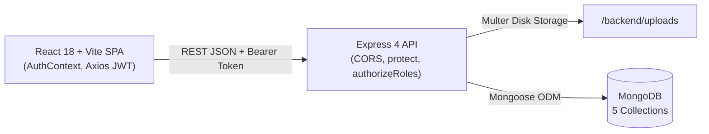
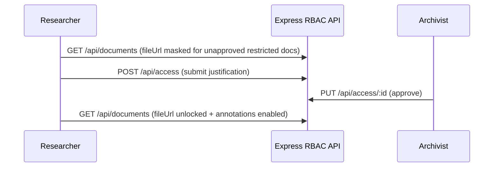

# Presentation Deck Blueprint — ChronicleVault (MERN Digital Archive System)

Use this slide-by-slide outline to build your **PowerPoint (`.pptx`)** or **PDF** presentation. Every endpoint, model, and feature below matches the codebase 100%.

---

## Slide 1: Title & Team Overview

- **Title:** ChronicleVault — Cloud-Based Digital Archive System
- **Subtitle:** Role-Based Historical Document Preservation, Access Governance & Research Platform (MERN Stack)
- **Presenter / Team Roles (fill in team names):**
  - *Backend & Security Lead:* Express REST API, Mongoose Models, JWT & RBAC Middleware, Multer File Storage
  - *Frontend & UX Lead:* React + Vite Dashboards, Axios Interceptors, Responsive Archival UI
  - *QA & Documentation Lead:* Seed Scripts, Unit & Smoke Tests, README & Presentation Deck
- **Visual Placeholder:**
  - `[Screenshot: Login / Role-Selection Screen with ChronicleVault branding & demo quick-fill bar]`

---

## Slide 2: Problem Statement & Solution Design

- **The Problem:**
  - Fragile historical records lack centralized metadata, preservation format tracking, and controlled access.
  - Public portals often expose sensitive holdings or fail to support scholarly workflows like clearance requests and research notes.
- **Our Solution (3 Role-Tailored Workflows):**
  1. **Archivist:** Ingests files + metadata, audits preservation status (`Digitized` / `Verified` / `Needs Migration`), approves/rejects clearance requests, exports CSV inventory.
  2. **Researcher:** Searches full catalog, requests access to restricted documents, views cleared records, manages private research annotations.
  3. **Public User:** Searches verified public holdings, inspects metadata & files, copies citations, submits 1–5 star feedback.
- **Architecture Diagram (embed in slide):**

---

## Slide 3: System & Data Design

- **5 Core MongoDB / Mongoose Models (`/backend/models`):**
  1. `User`: `name`, `email` (unique), `password` (bcrypt hashed), `role` (`archivist` | `researcher` | `public`)
  2. `Document`: `title`, `description`, `category`, `historicalEra`, `accessLevel` (`public` | `restricted`), `preservationFormat`, `preservationStatus`, `fileUrl`, `uploadedBy`
  3. `AccessRequest`: `researcher`, `document`, `reason`, `status` (`pending` | `approved` | `rejected`), `reviewedBy`
  4. `Annotation`: `researcher`, `document`, `noteText`
  5. `Feedback`: `user`, `userName`, `message`, `rating` (1–5)
- **Access Governance Flow (embed diagram):**

- **Visual Placeholder:**
  - `[Diagram/Screenshot: Responsive layout on desktop & mobile showing color-coded status badges]`

---

## Slide 4: Implementation & Innovation Highlights

- **Clean Modular Architecture:**
  - Backend: `routes/` → `controllers/` → `models/`, plus `middleware/` (`authMiddleware`, `uploadMiddleware`, `errorMiddleware`).
  - Frontend: `constants/` + `utils/` + reusable `FilePreview` & `DocumentViewerModal` + `AuthContext` + Axios interceptors.
- **Security & Extra Effort / Innovation:**
  - **Restricted URL Masking:** Backend strips `fileUrl` from `/api/documents` and `/api/access` responses until an Archivist approves access.
  - **Regex Escaping:** Prevents malformed regex crashes on special-character keyword searches.
  - **401 Auto-Logout:** Frontend interceptor clears expired sessions automatically.
  - **One-Click Archival Citation Copy & CSV Export:** Practical tools for researchers and archivists.
  - **Idempotent Seeder (`npm run seed`) + Quick Demo Login:** Instant evaluation setup.

---

## Slide 5: Testing Evidence & Execution

- **Automated Unit Tests (`npm test` via `node --test`):**
  - Validates `authorizeRoles` (200 pass vs. 403 block), `protect` (401 on missing token), `escapeRegex`, and `errorHandler` (`CastError` 400, duplicate key `11000` 409).
- **End-to-End API Smoke Script (`npm run verify`):**
  - Verifies health check, 3-role registration, 403 upload block for `public`, `archivist` multipart upload, `public` visibility filtering, `researcher` access request -> `archivist` approval -> annotation creation, preservation update, document deletion, and feedback creation.
- **Visual Placeholders (capture once running locally):**
  - `[Screenshot 1: Archivist Dashboard — Upload form, Access Approval table & CSV Export]`
  - `[Screenshot 2: Researcher Dashboard — Search cards with "Request Access" vs "View Document" & Notes tab]`
  - `[Screenshot 3: Public Dashboard — Metadata Viewer, File Preview & 5-Star Feedback]`
  - `[Screenshot 4: Terminal output showing npm test and npm run verify passing]`

---

## Slide 6: Setup, Demo & Next Steps

- **Quick Start Commands:**
  - Backend: `cd backend && npm install && npm run seed && npm start` (Port `5000`)
  - Frontend: `cd frontend && npm install && npm run dev` (Port `5173`)
- **GitHub Repository:** `https://github.com/sakshiguptawork/digital-archive-system`
- **Planned Future Enhancements:**
  - Cloud object storage integration (AWS S3 / Google Cloud Storage) in place of local `/uploads`
  - Full-text OCR indexing for scanned PDFs & TIFF manuscripts
  - Audit trail history log for preservation migrations and access reviews
