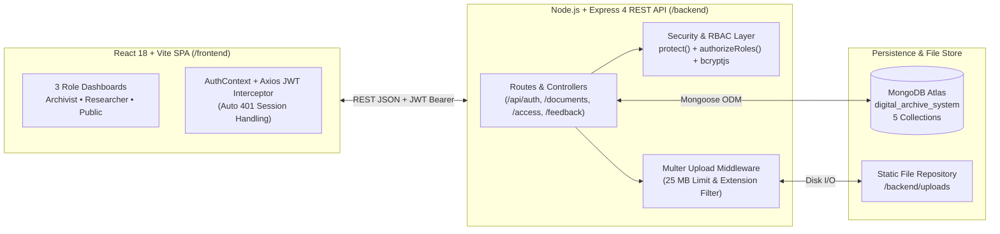
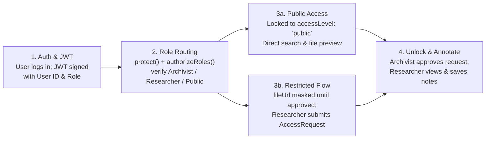

# ChronicleVault — Cloud-Based Digital Archive System
## Complete 10-Slide Presentation Deck (Team Limitless)

---

## Slide 1: Title & Team Overview

**PROJECT REVIEW SUBMISSION • MERN FULL-STACK APPLICATION**

# ChronicleVault: Cloud-Based Digital Archive System
*Secure Historical Document Preservation, Role-Based Access Governance & Multi-Tier Retrieval Platform*

- **Team Name:** Team Limitless
- **Team Members & Collaboration Breakdown:**
  - **Sakshi Gupta** — System Architecture, Express REST API, Mongoose Data Modeling & GitHub Integration
  - **Mayank** — Authentication (`JWT`, `bcryptjs`), RBAC Security Middleware & Multer Upload Engine
  - **Pranay** — React.js (Vite) Frontend Architecture, Role-Based Dashboards & Responsive Archival UI
  - **Daksh** — Database Seeding, Automated Testing (`unit.test.js`, `verifyApi.js`) & Documentation
- **Tech Stack:** React.js (Vite) • Node.js & Express.js • MongoDB Atlas & Mongoose • JWT Authentication & Multer Storage
- **GitHub Repository:** https://github.com/sakshiguptawork/digital-archive-system *(Public Access Verified)*

---

## Slide 2: Project Overview & Scope — Problem Statement & User Roles

### Problem Addressed & Core Objective
- Physical archives face degradation, fragmented cataloging, slow manual retrieval, and lack of role-specific security.
- **ChronicleVault** centralizes historical records in MongoDB Atlas with digital preservation tracking, multi-filter search, and strict Role-Based Access Control (RBAC).

### 3 User Roles & Capabilities
| Role | Core Capabilities |
| :--- | :--- |
| **Archivist (Admin)** | Uploads archival files & metadata (`multer`); manages preservation formats (`PDF/A`, `TIFF`, `TXT/UTF-8`) & statuses (`Digitized`, `Verified`, `Needs Migration`); approves/rejects researcher access requests; exports inventory CSV & deletes records. |
| **Researcher** | Searches across public & restricted records; submits justified access requests (`AccessRequest`); unlocks approved restricted files; creates & deletes private document annotations (`Annotation`). |
| **Public User** | Searches open-access (`accessLevel: 'public'`) historical collections; inspects metadata, previews files & copies formatted citations; submits 1–5 star ratings & archive feedback (`Feedback`). |

---

## Slide 3: Solution & Technical Design — Three-Tier MERN Architecture

### Key Architectural Highlights
- **Decoupled Client-Server Design:** React SPA communicates via Axios with an Express REST API secured by stateless JWT Bearer tokens and configured CORS (`http://localhost:5173`).
- **Hybrid Storage Engine:** Structured metadata & relational references stored in MongoDB Atlas (`digital_archive_system`); uploaded archival files handled by Multer and served statically via `/uploads`.

---

## Slide 4: Data Modeling & Persistence — Normalized MongoDB Schemas

### 5 Mongoose Collections & Relationships (`digital_archive_system`)
1. **`users`** (`User`): `name`, `email` (unique), `password` (bcrypt hashed via pre-save hook), `role` (`archivist` | `researcher` | `public`), timestamps.
2. **`documents`** (`Document`): `title`, `description`, `category`, `historicalEra`, `accessLevel` (`public` | `restricted`), `preservationFormat`, `preservationStatus` (`Digitized` | `Verified` | `Needs Migration`), `fileUrl`, `uploadedBy` (`ObjectId -> User`), text index on `title` & `description`.
3. **`accessrequests`** (`AccessRequest`): `researcher` (`ObjectId -> User`), `document` (`ObjectId -> Document`), `reason`, `status` (`pending` | `approved` | `rejected`), `reviewedBy` (`ObjectId -> User`), timestamps.
4. **`annotations`** (`Annotation`): `researcher` (`ObjectId -> User`), `document` (`ObjectId -> Document`), `noteText`, timestamps.
5. **`feedbacks`** (`Feedback`): `user` (`ObjectId -> User`), `userName`, `message`, `rating` (1–5), timestamps.

> **[SCREENSHOT PLACEHOLDER: MongoDB Atlas Collections]**  
> *Paste a screenshot of your `digital_archive_system` database in MongoDB Atlas / Compass showing the 5 collections (`users`, `documents`, `accessrequests`, `annotations`, `feedbacks`) and seeded JSON documents.*

---

## Slide 5: Security & Permission Governance — Authentication & RBAC

### Security Controls Implemented
- **`protect()` Middleware:** Extracts Bearer JWT, verifies signature, fetches user profile (excluding password), and attaches `req.user`.
- **`authorizeRoles(...roles)` Middleware:** Rejects unauthorized roles with `403 Forbidden`.
- **Query-Level Data Isolation & URL Masking:**
  - `public` users are forcibly scoped to `accessLevel: 'public'`.
  - `researcher` responses mask `fileUrl: null` on restricted documents until an `AccessRequest` has `status: 'approved'`.

---

## Slide 6: Core Functionalities (Admin) — Archivist Control Center

### Archivist Capabilities (`/archivist`)
- **Archive Management:** Multipart upload form (`POST /api/documents`) powered by Multer storing files up to 25 MB with `category`, `historicalEra`, `accessLevel`, `preservationFormat`, and `preservationStatus`.
- **User Access Management:** Live table of researcher clearance requests (`GET /api/access`) with one-click **Approve** / **Reject** controls (`PUT /api/access/:id`).
- **Document Preservation:** Searchable inventory table with inline format selector, **Verify** / **Flag Migration** actions (`PUT /api/documents/:id/preservation`), **Delete** with cascade cleanup (`DELETE /api/documents/:id`), and **Export CSV**.

> **[SCREENSHOT PLACEHOLDER: Archivist Control Center UI]**  
> *Paste a screenshot of the logged-in Archivist Dashboard (`archivist@archive.org`) showing the summary KPI cards, Document Upload form, Access Requests table, and Preservation Inventory.*

---

## Slide 7: Core Functionalities (End Users) — Researcher Workspace & Public Portal

### Researcher Workspace (`/researcher`)
- Multi-filter search (`keyword`, `category`, `historicalEra`) across full archive metadata.
- Context-aware action buttons: **View Document** for public or approved restricted records; **Request Access** modal for unapproved restricted records.
- **Document Access Status** table + private **Annotation & Notes** tab (`POST /api/documents/:id/annotations`, `GET /api/documents/annotations/my`, `DELETE /api/documents/annotations/:annotationId`).

### Public User Portal (`/public`)
- Clean search interface locked strictly to `public` historical records.
- Split-panel **Document Viewer** with metadata inspection, inline image/PDF/text preview, direct file link, and **Copy Citation**.
- Integrated **1–5 Star Rating** picker and community feedback feed (`POST /api/feedback`, `GET /api/feedback`).

> **[SCREENSHOT PLACEHOLDER: Researcher Dashboard UI & Public Portal UI]**  
> *Paste side-by-side screenshots showing: (Left) Researcher Workspace with access badges & notes, and (Right) Public Portal with metadata viewer & 5-star feedback.*

---

## Slide 8: Rubric Alignment & Engineering Standards

### Modular Architecture & Coding Standards
- **Clean Separation of Concerns:**
  - Backend: `config/`, `middleware/`, `models/`, `controllers/`, `routes/`, `scripts/`, `tests/`.
  - Frontend: `constants/`, `utils/`, `services/`, `context/`, `components/`, `pages/`, `styles/`.
- **Security & Error Hygiene:** Secrets isolated in `.env` (with `.env.example` committed and `.env` ignored via `.gitignore`); centralized `errorHandler` maps `CastError`, `ValidationError`, duplicate keys (`11000`), Multer size limits, and malformed JSON.
- **Zero Duplication:** Shared `FilePreview` modal/panel component, `archiveOptions.js`, and `documentHelpers.js`.

### Innovation & Extra Effort Highlights
- **Restricted File URL Masking:** Prevents leaking restricted file paths before Archivist clearance.
- **One-Click Archival Citation Copy & CSV Inventory Export:** Practical scholarly and curatorial utilities.
- **Regex Escaping (`escapeRegex`) & 401 Auto-Logout:** Resilient against special-character search inputs and expired tokens.
- **Idempotent Demo Seeder (`npm run seed`) & Quick Demo Sign-In:** Streamlines evaluation and onboarding.

---

## Slide 9: Verification & QA Results — Execution & Testing Evidence

| Test Suite / Module | Test Case Scenario | Expected & Observed Result | Status |
| :--- | :--- | :--- | :--- |
| **Unit Tests (`npm test`)** | `escapeRegex`, `authorizeRoles`, `protect` missing token, `errorHandler` | 4/4 tests executed via `node --test`; 401/403/400/409 verified | **PASSED** |
| **Frontend Build (`npm run build`)** | Vite production bundle compilation | 105 modules transformed cleanly into `/dist` in 1.87s | **PASSED** |
| **Database Seed (`npm run seed`)** | Seed MongoDB Atlas (`digital_archive_system`) | 3 role users, 4 sample records, requests, notes & feedback seeded | **PASSED** |
| **Auth & RBAC (`verifyApi.js`)** | 3-role register + `public` upload denial check | JWT issued; `public` POST `/api/documents` blocked with `403` | **PASSED** |
| **Upload & Isolation (`verifyApi.js`)** | Archivist restricted upload + `public` search check | Saved in `/uploads` & Atlas; `public` search returns `0` restricted docs | **PASSED** |
| **Access, Notes & Feedback (`verifyApi.js`)** | Request -> Approve -> Annotate -> Preserve -> Delete -> Feedback | End-to-end persistence and cascade cleanup verified (`200`/`201`) | **PASSED** |

> **[SCREENSHOT PLACEHOLDER: Terminal & Live Verification Evidence]**  
> *Paste a combined screenshot showing terminal output of `npm.cmd test` (4/4 pass), `npm.cmd run seed` (Atlas connected), and `npm.cmd run verify` (8/8 checks pass).*

---

## Slide 10: Submission & Next Steps — GitHub Readiness & Roadmap

### GitHub Repository & Submission Checklist
- **Public GitHub Repository:** https://github.com/sakshiguptawork/digital-archive-system
- **Complete Monorepo Structure:** `/backend`, `/frontend`, `/docs/PRESENTATION.md`, `.gitignore`, `README.md`, and `.env.example` templates included.
- **Clean Repo Hygiene:** `node_modules/`, `backend/.env`, `frontend/dist/`, and uploaded test artifacts excluded while preserving `backend/uploads/.gitkeep`.
- **Quick Run Commands:**
  - Backend: `cd backend && npm install && npm run seed && npm start` (Port `5000`)
  - Frontend: `cd frontend && npm install && npm run dev` (Port `5173`)

### Future Roadmap
- Cloud object storage integration (**AWS S3 / Google Cloud Storage**) replacing local `/uploads`.
- **OCR Full-Text Indexing** for scanned historical PDFs and TIFF manuscripts.
- **SHA-256 Checksum Verification** & immutable audit trail logs for long-term digital preservation.

> **[SCREENSHOT PLACEHOLDER: Public GitHub Repository Page]**  
> *Paste a screenshot of `https://github.com/sakshiguptawork/digital-archive-system` showing `/backend`, `/frontend`, `/docs`, and rendered `README.md`.*
